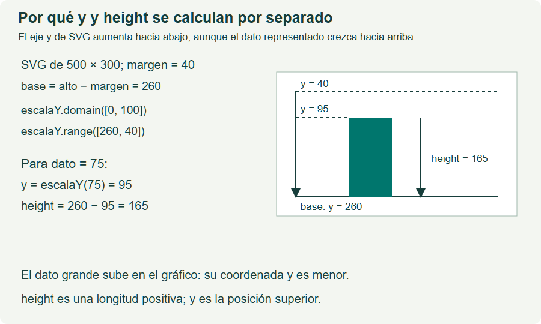

# Documentación de los ejemplos: gráficos, storytelling y dashboard

**Material de apoyo para el docente y el estudiante.**

Este documento explica los tres casos de la carpeta [ejemplos-clase](./ejemplos-clase/index.html). La finalidad es aprender a construir visualizaciones sencillas con D3 y SVG, comprobar sus cifras y comunicar una interpretación fundamentada.

Los casos comparten datos y presentación. La progresión consiste en construir primero un gráfico autónomo, relacionar después varios gráficos mediante una narración y terminar con un dashboard que permite explorar los datos.

## 1. Objetivos de aprendizaje

Al completar el recorrido, el estudiante debe poder:

1. Formular una pregunta que pueda responder con los datos disponibles.
2. Reconocer qué representa cada fila y qué unidad se está midiendo.
3. Separar los datos de las dimensiones del dibujo.
4. Utilizar escalas para convertir cantidades en posiciones y longitudes.
5. Construir un gráfico con ejes, etiquetas, fuente y período.
6. Relacionar varios gráficos sin cambiar el significado de las medidas.
7. Calcular e interpretar variaciones, participaciones y cumplimiento de objetivos.
8. Actualizar indicadores, gráficos y tabla con un mismo filtro.
9. Distinguir una observación, una interpretación y una propuesta que requiere más información.

## 2. Archivos y ejecución

### 2.1. Dónde está cada ejemplo

| Caso | Página que se abre | Código del ejemplo | Guía docente |
| --- | --- | --- | --- |
| 1. Gráfico independiente | [Abrir gráfico](./ejemplos-clase/01-grafico-independiente/index.html) | [grafico.js](./ejemplos-clase/01-grafico-independiente/js/grafico.js) | [Guía de clase 1](./ejemplos-clase/01-grafico-independiente/GUIA_CLASE.md) |
| 2. Storytelling | [Abrir historia](./ejemplos-clase/02-storytelling/index.html) | [historia.js](./ejemplos-clase/02-storytelling/js/historia.js) | [Guía de clase 2](./ejemplos-clase/02-storytelling/GUIA_CLASE.md) |
| 3. Dashboard | [Abrir dashboard](./ejemplos-clase/03-dashboard/index.html) | [dashboard.js](./ejemplos-clase/03-dashboard/js/dashboard.js) | [Guía de clase 3](./ejemplos-clase/03-dashboard/GUIA_CLASE.md) |

Los datos que ejecutan los tres casos están en [ventas.js](./ejemplos-clase/datos/ventas.js). También se proporciona [ventas.csv](./ejemplos-clase/datos/ventas.csv) para practicar posteriormente la lectura de archivos.

### 2.2. Cómo abrirlos

1. Conserva toda la carpeta del proyecto.
2. Abre [el índice de ejemplos](./ejemplos-clase/index.html) en el navegador.
3. Elige un caso y observa su resultado.
4. Abre el HTML y su archivo JavaScript en un editor.
5. Modifica una instrucción, guarda y recarga el navegador.

Estos tres casos funcionan al abrir los HTML directamente y sin conexión. Los datos se cargan con una etiqueta `script`; no se hace una petición `fetch` ni una lectura automática del CSV. El recorrido de carga de datos del temario sí requiere HTTP para sus ejemplos de lectura mediante URL.

En cada caso se respeta este orden:

```html
<script src="../../vendor/d3.min.js"></script>
<script src="../datos/ventas.js"></script>
<script src="js/grafico.js"></script>
```

El tercer archivo cambia según el caso. D3 debe estar disponible antes del código que lo utiliza, y los datos deben estar definidos antes de dibujarlos. Los tres scripts se colocan al final del cuerpo del HTML, después de los elementos que seleccionan.

## 3. Contexto y diccionario de datos

Los datos representan una **librería universitaria ficticia** durante seis meses, de enero a junio. No se asigna un año concreto. Todos los valores son sintéticos y su finalidad es didáctica.

La unidad es **ejemplares vendidos**, no ingresos ni beneficios. Los objetivos son cantidades de venta planificadas para el ejercicio.

| Campo | Significado | Tipo |
| --- | --- | --- |
| `mes` | Mes al que corresponde el registro. | Texto |
| `tienda` | Ejemplares vendidos en la tienda física. | Número |
| `online` | Ejemplares vendidos por el canal online. | Número |
| `objetivoTienda` | Objetivo de venta de la tienda física. | Número |
| `objetivoOnline` | Objetivo de venta del canal online. | Número |

### 3.1. Datos iniciales

| Mes | Tienda | Online | Total vendido | Objetivo tienda | Objetivo online | Objetivo total |
| --- | ---: | ---: | ---: | ---: | ---: | ---: |
| Enero | 80 | 20 | 100 | 85 | 25 | 110 |
| Febrero | 90 | 30 | 120 | 95 | 35 | 130 |
| Marzo | 100 | 40 | 140 | 105 | 45 | 150 |
| Abril | 110 | 60 | 170 | 115 | 65 | 180 |
| Mayo | 120 | 90 | 210 | 125 | 95 | 220 |
| Junio | 130 | 130 | 260 | 135 | 115 | 250 |
| **Período** | **630** | **370** | **1000** | **660** | **380** | **1040** |

Las columnas de total se calculan sumando canales; no son propiedades guardadas en el archivo.

### 3.2. Cómo leer un registro en JavaScript

```javascript
const enero = datos[0];
const totalEnero = enero.tienda + enero.online;
```

- `datos` es un array: una colección ordenada de registros.
- Los índices comienzan en cero. `datos[0]` obtiene el primer registro.
- Cada registro es un objeto: reúne propiedades con nombre.
- El punto permite leer una propiedad. `enero.tienda` vale 80.
- `totalEnero` vale 100 porque suma dos cantidades expresadas en la misma unidad.

El array `meses` fija el orden del eje. Contiene los nombres desde enero hasta junio. D3 no deduce el orden cronológico de esos textos.

## 4. Conceptos comunes que debemos distinguir

| Concepto | Qué hace en estos ejemplos |
| --- | --- |
| HTML | Organiza títulos, párrafos, botones, tablas y el SVG. |
| SVG | Define los elementos del dibujo, como rectángulos, líneas y texto. |
| CSS | Controla presentación, colores, separación y adaptación de las páginas. |
| JavaScript | Realiza cálculos y define qué sucede ante una interacción. |
| D3 | Selecciona elementos, enlaza datos, calcula escalas y genera ejes o rutas. |
| `select` | Selecciona la primera coincidencia dentro del ámbito consultado. |
| `selectAll` | Selecciona todas las coincidencias dentro del ámbito consultado. |
| `data` | Asigna registros a los elementos seleccionados; por sí solo no crea nuevos elementos. |
| `attr` | Lee o cambia un atributo del elemento seleccionado. |
| `text` | Cambia el contenido textual de un elemento. |

### 4.1. Qué significa d dentro de una función

```javascript
const barras = d3.select("#barras").selectAll("rect").data(datos);
barras.attr("y", function(d) {
  return y(d.tienda + d.online);
});
```

Este fragmento pertenece al caso 1 y utiliza la escala `y` definida antes en su archivo.

`#barras` identifica un grupo del SVG. Dentro de ese grupo se seleccionan sus rectángulos. `data(datos)` asigna un registro a cada uno, por orden. Cuando D3 llama a la función para calcular el atributo de un rectángulo, `d` recibe el registro de ese rectángulo.

`d` es un nombre de parámetro elegido por quien programa; no es un comando. `return` entrega el resultado de la función. Aquí entrega la coordenada que produce la escala para la suma de ventas de ese mes.

### 4.2. La tabla y la herencia del dato

```javascript
const filas = d3.select("#tabla-datos").selectAll("tbody tr").data(datos);
filas.select(".ventas").text(function(d) {
  return d.tienda + d.online;
});
```

Cada fila recibe un mes. `filas.select(".ventas")` busca la primera celda de esa clase dentro de cada fila y transmite a la celda el dato de su fila. Por eso la función puede leer las ventas del mes correspondiente. El selector `.ventas` indica una clase CSS; `#tabla-datos` indica un identificador.

Consulta [selection.select](./d3/selecciones/selection.select.html) para ampliar esta relación entre ubicación en el DOM y propagación del dato.

## 5. Dimensiones, márgenes y sistema de coordenadas

### 5.1. El vector de dimensiones

```javascript
const dimensiones = [640, 360];
const ancho = dimensiones[0];
const alto = dimensiones[1];
```

La pareja contiene ancho y alto del sistema de coordenadas SVG. No contiene observaciones de ventas.

El ejemplo asigna el resultado al `viewBox`:

```javascript
d3.select("#grafico").attr("viewBox", "0 0 " + ancho + " " + alto);
```

El texto final es `0 0 640 360`: origen horizontal, origen vertical, anchura y altura del área de referencia. El navegador puede mostrar ese dibujo a otro tamaño mediante CSS. **640 unidades SVG no significan necesariamente 640 píxeles en pantalla.**

### 5.2. Espacio útil

| Medida | Valor inicial |
| --- | ---: |
| Ancho del SVG | 640 |
| Alto del SVG | 360 |
| Margen izquierdo | 70 |
| Margen derecho | 30 |
| Margen superior | 40 |
| Margen inferior | 70 |
| Anchura útil | 640 − 70 − 30 = 540 |
| Altura útil | 360 − 40 − 70 = 250 |
| Coordenada de la base | 360 − 70 = 290 |

Los márgenes reservan espacio para títulos, ejes y etiquetas. La escala horizontal ocupa [70, 610] y la vertical [290, 40]. Se utilizan coordenadas del SVG completo; no hay un grupo adicional que vuelva a trasladar todo el gráfico mediante esos mismos márgenes.

### 5.3. Por qué se invierte el rango vertical

En SVG, el origen está arriba a la izquierda. La coordenada x aumenta hacia la derecha y la coordenada y hacia abajo.

```javascript
const y = d3.scaleLinear();
y.domain([0, 300]);
y.range([290, 40]);
```

Con esta escala:

- Una venta de 0 queda en y = 290: la base.
- Una venta de 300 queda en y = 40: la parte superior del área útil.
- Una venta de 100 queda aproximadamente en y = 206,67.

La altura de la barra de enero es 290 − 206,67 = 83,33. Su posición y su altura son distintas. Si se asignara `y(100)` a `height`, se estaría confundiendo una coordenada con una longitud.



La infografía utiliza su propio ejemplo numérico; sus dimensiones no son las del caso de la librería. La relación que se debe reconocer es la misma: altura = base − posición superior.

## 6. Caso 1: gráfico independiente

**Pregunta:** ¿cómo evolucionan las ventas mensuales?

**Producto:** un gráfico de barras con ejes, etiquetas y una tabla.

**Tiempo orientativo:** 35 minutos, después de conocer las operaciones básicas del temario.

### 6.1. Qué debe aprender el estudiante

Un gráfico autónomo debe comunicar qué se mide, con qué unidad, durante qué período y de dónde proceden los datos. Las barras permiten comparar cantidades; el orden temporal permite reconocer la evolución.

El gráfico suma tienda y online para cada mes. No representa ingresos, beneficios ni ventas acumuladas hasta cada fecha.

### 6.2. Secuencia de construcción

1. Escribir seis rectángulos y seis etiquetas de texto en el HTML.
2. Definir dimensiones y márgenes.
3. Crear una escala de bandas para los meses.
4. Crear una escala lineal para las cantidades.
5. Colocar y dibujar los ejes.
6. Asignar un mes a cada rectángulo.
7. Aplicar x, y, width y height.
8. Añadir las cifras y completar la tabla.

### 6.3. Escala de bandas

```javascript
const x = d3.scaleBand();
x.domain(meses);
x.range([70, 610]);
x.padding(0.25);
```

`x("Enero")` devuelve el inicio de la banda de enero. `x.bandwidth()` devuelve la anchura disponible para una barra. `padding(0.25)` añade separación entre bandas y en los extremos; no significa reservar el 25 % del ancho total del SVG.

Para centrar una etiqueta se utiliza:

```javascript
const centroEnero = x("Enero") + x.bandwidth() / 2;
```

La coordenada del inicio de una banda no es la de su centro.

### 6.4. Ejes y posición

El eje inferior usa la escala x y se coloca en la base. El eje izquierdo usa y y se coloca en x = 70. `axisBottom` y `axisLeft` determinan la orientación de las marcas; el atributo `transform` sitúa el grupo que contiene cada eje.

`axisLeft(y).ticks(6)` solicita una cantidad orientativa de marcas. No garantiza exactamente seis etiquetas: en este dominio se obtienen 0, 50, 100, 150, 200, 250 y 300.

### 6.5. Resultados iniciales

| Mes | Ventas totales | Coordenada y aproximada | Altura aproximada |
| --- | ---: | ---: | ---: |
| Enero | 100 | 206,67 | 83,33 |
| Febrero | 120 | 190,00 | 100,00 |
| Marzo | 140 | 173,33 | 116,67 |
| Abril | 170 | 148,33 | 141,67 |
| Mayo | 210 | 115,00 | 175,00 |
| Junio | 260 | 73,33 | 216,67 |

Todas las barras terminan en la misma base y el eje comienza en cero. El total del período es 1000 ejemplares.

### 6.6. Práctica y comprobación

| Cambio | Archivo | Resultado esperado |
| --- | --- | --- |
| Sustituir [640, 360] por [800, 360]. | `01-grafico-independiente/js/grafico.js` | Mayor anchura útil; mismas ventas y alturas. |
| Cambiar online de junio de 130 a 150. | `datos/ventas.js` | Junio = 280; total del período = 1020. |
| Cambiar el dominio vertical de [0, 300] a [0, 600]. | `01-grafico-independiente/js/grafico.js` | Las alturas se reducen a la mitad; los datos no cambian. |

Los archivos de la tabla están dentro de `ejemplos-clase/`. Restaura los valores iniciales antes del siguiente caso.

**Criterio de logro:** el estudiante justifica qué calcula cada atributo y presenta una conclusión descriptiva sin confundir ventas y beneficios.

## 7. Caso 2: storytelling con gráficos independientes

**Pregunta:** ¿cómo se descompone el cambio y qué conviene investigar antes de decidir?

**Producto:** tres gráficos separados relacionados por una secuencia explicativa.

**Tiempo orientativo:** 45 minutos.

### 7.1. Estructura de la narración

| Paso | Gráfico | Pregunta |
| --- | --- | --- |
| Contexto | Línea del total mensual. | ¿Qué cambió en el período? |
| Desglose | Barras agrupadas de tienda y online. | ¿Cómo evolucionó cada canal? |
| Aportación | Barras horizontales de las diferencias entre extremos. | ¿Qué parte del aumento neto corresponde a cada canal? |

Una narración orienta la lectura mediante preguntas y evidencias. Cada gráfico conserva título, unidad, período y fuente para que también se pueda interpretar de manera independiente.

### 7.2. Dibujar la línea

El código utiliza las escalas x e y ya definidas:

```javascript
const linea = d3.line();
linea.x(function(d) {
  return x(d.mes) + x.bandwidth() / 2;
});
linea.y(function(d) {
  return y(d.tienda + d.online);
});
d3.select("#linea-total").attr("d", linea(datos));
```

`linea` es el nombre de una variable elegida para guardar un generador. `linea(datos)` produce el texto de una ruta SVG; el atributo `d` del path recibe ese texto. Este atributo y el parámetro `d` de las funciones tienen nombres coincidentes, pero cumplen papeles diferentes.

La línea conecta las observaciones en el orden del array. No aporta datos de lo ocurrido entre dos meses.

### 7.3. Barras agrupadas

Las dos primeras vistas comparten dimensiones [640, 360], orden temporal y dominio vertical [0, 300].

Dentro de cada banda se colocan dos barras:

- Tienda comienza en `x(d.mes)`.
- Online comienza en `x(d.mes) + anchoBarra`.
- `anchoBarra` vale `x.bandwidth() / 2`.

La leyenda mantiene tienda en verde y online en ocre. Los datos exactos también están en la tabla: el color no es la única forma de distinguir canales.

### 7.4. Tres porcentajes que responden a preguntas distintas

| Medida | Cálculo con los datos iniciales | Interpretación |
| --- | --- | --- |
| Variación del total enero-junio | (260 − 100) / 100 = 1,60 | Aumento del 160 %. |
| Participación online en junio | 130 / 260 = 0,50 | Online representa el 50 % de las ventas de junio. |
| Aportación online al aumento neto | (130 − 20) / (260 − 100) = 0,6875 | Online aporta el 68,75 % del aumento entre extremos. |

El 260 % indica cuánto representa el valor final respecto al inicial. El aumento es del 160 % porque se resta el nivel de partida.

La participación online pasa del 20 % al 50 %: aumenta **30 puntos porcentuales**. Su crecimiento relativo como participación sería (50 − 20) / 20 = 150 %. No son medidas intercambiables.

### 7.5. Tercer gráfico: cantidades del cambio

La tienda aumenta 130 − 80 = 50 ejemplares y online aumenta 130 − 20 = 110. Las dos diferencias suman el aumento neto de 160.

Este gráfico usa dimensiones [640, 230]. La escala horizontal transforma [0, 160] en [100, 570]. Como devuelve posiciones, la anchura se calcula restando el origen:

```javascript
const longitud = xAporte(50) - xAporte(0);
```

El fragmento utiliza la escala `xAporte` definida en historia.js. El resultado es 146,875 unidades SVG. No debe confundirse el extremo de una barra con su longitud cuando el rango no empieza en cero.

### 7.6. Titulares calculados e interpretación

Los titulares se generan con los datos; los párrafos de cálculo de las páginas explican los valores iniciales. Tras modificar datos, comprueba los nuevos titulares y revisa si la interpretación sigue siendo válida.

Una exposición posible es:

> Las ventas mensuales pasan de 100 a 260 ejemplares. Online aumenta 110 y tienda 50; por tanto, online aporta el 68,75 % del aumento neto. Conviene estudiar la capacidad de preparación y entrega online antes de decidir si se reasignan recursos.

La propuesta requiere conocer carga de trabajo, costes, márgenes, tiempos y satisfacción. Los datos de ventas no demuestran que una campaña causara el crecimiento ni que sea necesario contratar.

### 7.7. Práctica y comprobación

Cambia online de junio de 130 a 90 en ventas.js. Debes obtener:

- Total final: 220.
- Aumento neto: 120.
- Aumento online: 70.
- Aportación online al aumento: 70 / 120 ≈ 58,33 %.
- Participación online en junio: 90 / 220 ≈ 40,91 %; el titular sin decimales muestra 41 %.

Presenta la nueva historia en noventa segundos y restaura el dato al terminar.

**Criterio de logro:** cada afirmación se verifica con un gráfico o cálculo y la propuesta distingue qué información falta.

## 8. Caso 3: dashboard con un filtro

**Pregunta:** ¿qué canal se acerca a sus objetivos?

**Producto:** cuatro indicadores, dos gráficos y una tabla que responden a la selección de canal.

**Tiempo orientativo:** 55 minutos.

### 8.1. Componentes del panel

| Componente | Qué informa |
| --- | --- |
| Ventas del período | Suma de ejemplares vendidos en los seis meses del canal seleccionado. |
| Objetivo del período | Suma de objetivos de esos mismos meses y canal. |
| Cumplimiento del período | Ventas del período / objetivo del período. |
| Cambio enero-junio | (Ventas de junio − ventas de enero) / ventas de enero. |
| Gráfico mensual | Ventas en barras y objetivos como marcas horizontales. |
| Gráfico de cumplimiento | Cociente ventas / objetivo de cada mes, con referencia del 100 %. |
| Tabla | Cifras mensuales exactas del mismo filtro. |

El cuarto indicador compara dos meses. No compara el semestre con otro semestre.

### 8.2. La variable que guarda el filtro

```javascript
let canal = "Total";
```

`canal` conserva la selección actual. Usamos `let` porque después se le asigna otro texto. `const` se utiliza cuando no se reasigna la referencia guardada en la variable; no convierte automáticamente un array u objeto en inmutable.

### 8.3. Funciones sencillas escritas por nosotros

```javascript
function ventaDelMes(d) {
  if (canal === "Tienda") { return d.tienda; }
  if (canal === "Online") { return d.online; }
  return d.tienda + d.online;
}
```

- `function` define una función y su nombre.
- `d` es el registro que recibe.
- `if` comprueba una condición.
- `===` compara valores sin convertir sus tipos.
- `return` entrega una respuesta y termina esa llamada.

`ventaDelMes` no es una función de D3: la escribimos para aplicar una regla común. `objetivoDelMes` hace lo mismo con los objetivos.

Para enero, ventaDelMes devuelve 80 si canal es Tienda, 20 si es Online y 100 si es Total.

### 8.4. Sumas y proporciones

```javascript
const total = d3.sum(datos, ventaDelMes);
const objetivo = d3.sum(datos, objetivoDelMes);
```

`d3.sum` recibe la colección y la función que indica qué número sumar de cada registro. Se escribe `ventaDelMes` sin paréntesis porque D3 debe llamarla con cada mes. `ventaDelMes()` la ejecutaría de inmediato sin proporcionarle ese registro.

El cumplimiento del período es:

**suma de ventas / suma de objetivos = 1000 / 1040 ≈ 96,15 %.**

El indicador muestra 96,2 % por redondeo. No se obtiene calculando una media simple de los porcentajes mensuales: los objetivos de los meses son diferentes. La media ponderada por los objetivos sí coincide con el cociente de sumas.

### 8.5. Actualizar todo con la misma selección

La función `actualizar(nuevoCanal)` realiza estas tareas:

1. Guarda nuevoCanal en la variable canal.
2. Calcula ventas, objetivos, cumplimiento y variación.
3. Cambia los cuatro indicadores y el texto de contexto.
4. Cambia barras, marcas de objetivo y etiquetas del primer gráfico.
5. Cambia longitudes y cifras del gráfico de cumplimiento.
6. Completa la tabla con los mismos cálculos.
7. Marca el botón activo mediante `aria-pressed`.

`aria-pressed` comunica el estado del botón, también a las tecnologías de asistencia. La selección no depende solamente de un cambio de color.

### 8.6. Eventos y primera representación

```javascript
d3.select("#filtro-online").on("click", function() {
  actualizar("Online");
});
```

`on` registra la función que debe ejecutarse ante un clic. La función no se ejecuta por el hecho de registrarla.

La llamada final:

```javascript
actualizar("Total");
```

dibuja la primera vista sin esperar una pulsación. Los botones cambian las propiedades que se leen; no eliminan meses del array.

### 8.7. Escalas y porcentajes

La escala de ventas conserva [0, 300] para los tres canales. Cambiar el filtro no cambia el significado de una altura.

La escala de cumplimiento tiene dominio [0, 1.5]:

| Valor numérico | Porcentaje |
| --- | ---: |
| 0 | 0 % |
| 0.5 | 50 % |
| 1 | 100 % |
| 1.5 | 150 % |

Su rango horizontal es [90, 540] con el ancho inicial de 640. La referencia del 100 % se coloca en `xCumple(1)`, que vale 390 unidades SVG. La columna de porcentajes se reserva a la derecha para que la línea de referencia no atraviese las cifras.

```javascript
const porcentaje = d3.format(".1%");
const texto = porcentaje(0.5);
```

El resultado es `50.0%`. D3 devuelve texto formateado; el dato original sigue siendo 0.5. El formato predeterminado usa punto decimal. Este documento usa coma decimal al escribir los cálculos en español.

### 8.8. Colocar etiquetas sin cruzar las marcas

En el gráfico mensual se compara la venta y el objetivo con `Math.max(a, b)`, una función de JavaScript que devuelve el mayor de dos números. La escala y transforma ese mayor valor en una posición y se restan 10 unidades para dejar el texto por encima de las dos marcas.

El color y la posición no sustituyen la comprobación numérica: la tabla permite leer ventas, objetivo y cociente del mismo mes y canal.

### 8.9. Resultados iniciales para verificar los filtros

| Canal | Ventas | Objetivo | Cumplimiento mostrado | Cambio enero-junio mostrado |
| --- | ---: | ---: | ---: | ---: |
| Total | 1000 | 1040 | 96,2 % | 160,0 % |
| Tienda | 630 | 660 | 95,5 % | 62,5 % |
| Online | 370 | 380 | 97,4 % | 550,0 % |

En junio, Total cumple el 104 %, Tienda aproximadamente el 96,3 % y Online aproximadamente el 113,0 %. El total supera su objetivo aunque la tienda física no alcance el suyo.

Un crecimiento online del 550 % no significa que online venda más que tienda durante el período: sus sumas son 370 y 630. Una variación relativa grande puede partir de una base pequeña.

### 8.10. Práctica y comprobación

1. Predice las cuatro cifras de cada filtro antes de pulsarlo.
2. Contrasta indicadores, gráficos y tabla.
3. Cambia objetivoOnline de junio de 115 a 130. Las ventas no cambian; el objetivo total del período pasa a 1055. Junio online cumple el 100 %.
4. Restaura el objetivo. Cambia dimensiones a [800, 400]. La base pasa a 330; los dos gráficos adaptan su espacio y los indicadores conservan sus cifras.
5. Restaura dimensiones y presenta una conclusión que nombre el filtro, la evidencia y una pregunta pendiente.

**Criterio de logro:** todas las vistas responden al mismo filtro y el estudiante puede explicar actualizar, las escalas y los denominadores.

## 9. Errores frecuentes y cómo detectarlos

| Error | Señal observable | Corrección |
| --- | --- | --- |
| Confundir y con height. | Las barras no terminan en la base correcta. | Calcular altura como base − posición superior. |
| Usar un array completo como width. | El atributo no recibe una longitud válida. | Extraer una medida o aplicar una escala a un dato. |
| Olvidar bandwidth. | Las barras no ocupan el espacio de cada categoría. | Usar x.bandwidth() en el gráfico simple. |
| Cambiar de escala al pulsar un filtro sin avisar. | Alturas parecidas representan cifras distintas. | Mantener los dominios de comparación en esta versión. |
| Confundir 1 y 100 en los cocientes. | Aparecen porcentajes cien veces mayores. | Formatear 1 como 100 %. |
| Actualizar solo el gráfico. | Indicadores o tabla muestran otro canal. | Reunir las operaciones dependientes del filtro en actualizar. |
| Añadir un séptimo mes solo a datos. | No aparece la nueva barra. | Adaptar nodos HTML y meses, o estudiar join. |
| Leer ventas como beneficios. | La conclusión menciona rentabilidad sin datos de costes. | Mantener la unidad e indicar información faltante. |
| Copiar un titular fijo después de cambiar datos. | El texto contradice las cifras. | Recalcular y revisar la interpretación. |

## 10. Secuencia de clase y evaluación

Los tres casos suman 135 minutos. Es una duración orientativa de aplicación, no incluye enseñar desde cero HTML, JavaScript y todo el temario de D3.

| Caso | Evidencia mínima de aprendizaje |
| --- | --- |
| Gráfico | Explicar x, y, width y height; comprobar un cambio de datos y otro de dimensiones. |
| Storytelling | Exposición de noventa segundos con pregunta, evidencia, denominadores correctos y propuesta condicionada. |
| Dashboard | Un filtro que mantiene coherentes indicadores, dos gráficos y tabla. |

Para cada producto se pueden asignar cuatro puntos: uno por cifras correctas, uno por construcción visual correcta, uno por explicación comprensible y uno por interpretación prudente. Los errores numéricos o las contradicciones entre vistas deben corregirse aunque la presentación resulte atractiva.

Como transferencia, pide utilizar datos propios no sensibles con seis categorías o meses. Exige fuente, unidad, período y explicación de las transformaciones realizadas.

## 11. Supuestos y límites antes de reutilizar el código

- Los ejemplos iniciales tienen seis registros y sus marcas ya existen en el HTML.
- Los nombres y el orden de meses deben corresponder con el array meses.
- Las ventas y los objetivos se guardan como números, no como textos.
- El dashboard supone objetivos positivos y ventas positivas en el primer mes; no define reglas para dividir entre cero.
- El storytelling de aportaciones supone aumentos no negativos y un aumento total positivo. Para descensos hacen falta dominios que incluyan negativos y un lenguaje adaptado.
- Las ventas mensuales se representan hasta 300; el aumento absoluto por canal, hasta 160; el cumplimiento, hasta 150 %. Las escalas no amplían esos límites automáticamente ni recortan por defecto los datos que los superen.
- Si se modifica ventas.js, se debe actualizar ventas.csv cuando se quiera mantener su equivalencia. Los casos ejecutan únicamente la versión JavaScript.
- El dashboard no recibe datos en tiempo real: cambia de filtro al pulsar botones y vuelve a leer los archivos al recargar la página.

Antes de aplicar el material a datos reales, decide cómo tratar registros ausentes, ceros, valores negativos, nuevos períodos y objetivos no definidos.

## 12. Material complementario y referencias

### Fichas del proyecto

- [Vectores y dimensiones](./d3/escalas/vectores-y-dimensiones.html).
- [select](./d3/selecciones/d3.select.html), [selectAll](./d3/selecciones/d3.selectAll.html) y [selection.data](./d3/selecciones/selection.data.html).
- [scaleLinear](./d3/escalas/d3.scaleLinear.html), [scaleBand](./d3/escalas/d3.scaleBand.html) y [range](./d3/escalas/scale.range.html).
- [axisBottom](./d3/ejes/d3.axisBottom.html), [axisLeft](./d3/ejes/d3.axisLeft.html) y [selection.on](./d3/selecciones/selection.on.html).
- [Infografías de referencia](./infografias.html).
- [Carga de datos](./carga-datos/index.html).

### Documentación oficial de D3

Las explicaciones y ejercicios de este documento se refieren a los archivos locales del proyecto, que utilizan D3 7.9.0. Para consultar las APIs:

- [Selecciones y consultas](https://d3js.org/d3-selection/selecting).
- [Asignación de datos](https://d3js.org/d3-selection/joining).
- [Escalas de bandas](https://d3js.org/d3-scale/band).
- [Escalas lineales](https://d3js.org/d3-scale/linear).
- [Ejes](https://d3js.org/d3-axis).
- [Generador de líneas](https://d3js.org/d3-shape/line).
- [Sumas y resúmenes](https://d3js.org/d3-array/summarize).
- [Formato numérico](https://d3js.org/d3-format).
- [Eventos](https://d3js.org/d3-selection/events).

## 13. Versión adicional: dashboard responsive y compacto

La carpeta [04-dashboard-responsive](./ejemplos-clase/04-dashboard-responsive/dashboard-responsive.html) desarrolla una variante del caso 3. Conserva el dashboard original y sus cálculos. La presentación añade dos gráficos por fila desde 960 píxeles CSS, una columna por debajo de ese umbral, cuatro indicadores por fila en escritorio y dos en pantallas estrechas.

El SVG usa un viewBox de 600 × 320, ancho visible del 100 % y altura automática. CSS Grid distribuye los recuadros; una media query cambia el número de columnas. El eje mensual abrevia los meses con slice(0, 3), método de texto que conserva sus tres primeros caracteres.

El botón de impresión abre window.print(). Las reglas @page y @media print preparan el resumen en A4 horizontal, con dos gráficos y cuatro indicadores. Navegación, controles y tabla plegable no se incluyen en esa hoja. La tabla permanece disponible para consulta en pantalla y responde al mismo filtro.

Consulta la [guía de la versión responsive](./ejemplos-clase/04-dashboard-responsive/LEEME.md) para explicar las reglas CSS, las dimensiones y las prácticas de adaptación e impresión.
